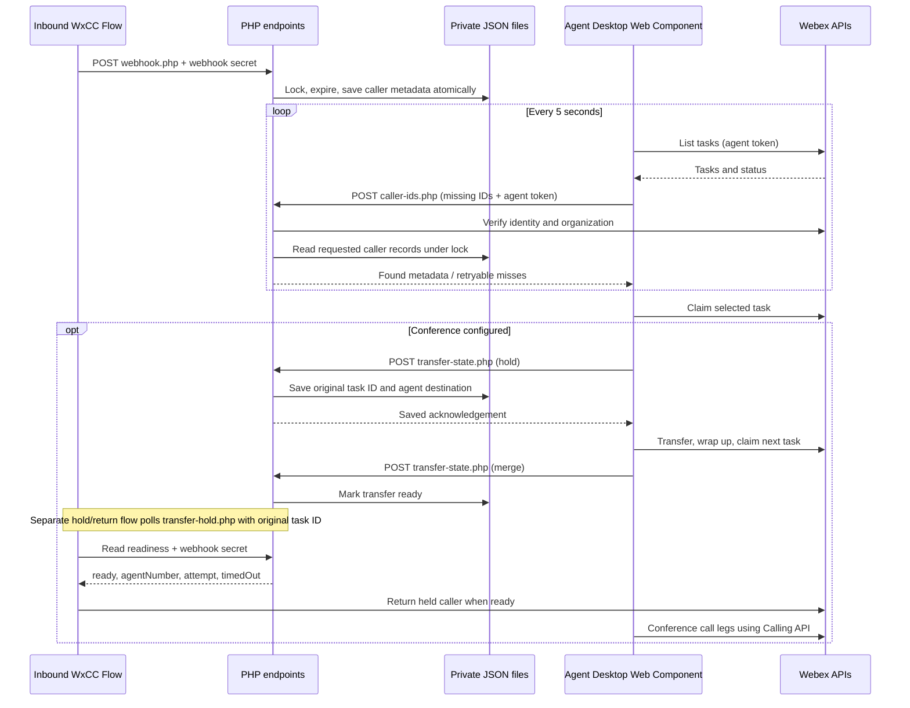

# PHP + JSON file architecture

PHP serves individual requests; there is no persistent Node or Socket.io process. `callers.json` and `transfers.json` use separate stable lock files, atomic replacements, and expiry timestamps. Store them outside the web document root on the same local server.
